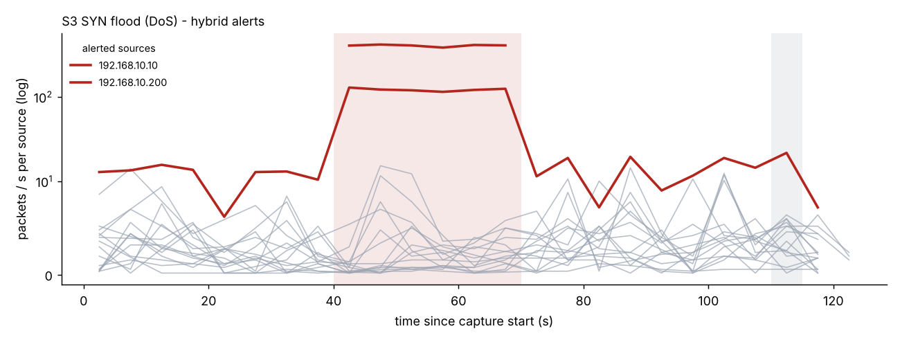
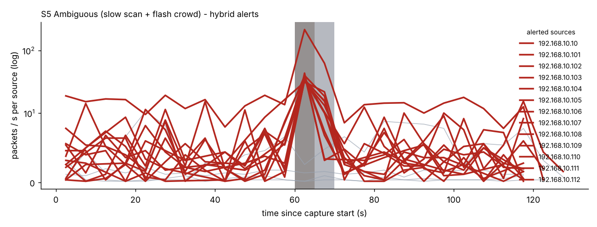

# AI-Driven Network Traffic Analysis and Intrusion Detection System
**Technical report - Megaminds IT Services, Cybersecurity Research Intern assessment (Round 1)**

## 1. Problem overview
Signature-based detection catches attacks someone already wrote a rule for; it struggles with variants and novel behaviour. Behavioural and ML approaches look at *how a host acts* instead. The task is to build a prototype that ingests network traffic, extracts features, detects intrusions, and presents results an analyst can act on. I built a **hybrid** detector: an auditable rule layer for known attack behaviours plus an unsupervised anomaly model for everything the rules do not describe.

## 2. Objectives
1. Obtain traffic containing benign behaviour, reconnaissance, DoS and one further attack.
2. Extract features that separate those behaviours.
3. Detect them with a justified method.
4. Explain every alert (what, why, how severe/confident).
5. Provide a runnable CLI and dashboard.
6. Evaluate honestly, including failures, and state limitations.

## 3. Traffic data
**Choice: a seeded synthetic LAN, written as real pcap files.** Attacks may only be run against systems one owns, and a multi-host lab was not available for this assignment; a deterministic generator also makes every number here reproducible (`python generate_traffic.py`). The frames are valid Ethernet/IPv4/TCP/UDP/ICMP/ARP with correct checksums, open in Wireshark, and can be replayed in a lab with `tcpreplay`. The reader also accepts real classic-pcap captures.

Topology: one /24 with a gateway, web, SSH and DNS server, 12 benign clients and one attacker. Benign behaviour is a Poisson mix per client: HTTP(S) sessions (55 %), DNS (30 %), interactive SSH (7 %), ping (8 %), plus ARP bootstrap and refresh. Eight captures:

| Capture | Purpose |
|---|---|
| `train_benign` (300 s), `val_benign` (300 s) | fit the anomaly model / calibrate its threshold |
| `s1_normal` | Scenario 1 - benign baseline |
| `s2_portscan` | nmap-style SYN scan, 1,000 ports at ~100/s |
| `s3_dos` | hping3-style SYN flood, ~400 SYN/s for 30 s; legitimate clients degrade (generator models 25 % success and 40x slower handshakes during the flood; the measured value from the pcap is in Section 7) |
| `s4a_bruteforce` / `s4b_arpspoof` | SSH password guessing ~6/s; ARP cache poisoning of victim and gateway at 1 Hz |
| `s5_ambiguous` | a low-and-slow scan (one port every 2-4 s) **and** a benign flash crowd (12 clients x 25 successful HTTP connections in 6 s) |

Each capture has a `.labels.json` ground truth (attacker, interval, victims). **Important caveat:** because I wrote both the generator and the detector, results are an *optimistic* functional test, not evidence of real-world accuracy (Section 9).

## 4. System architecture
`pcap -> parser -> flow tracker + windowed feature extraction -> {rule layer, Isolation Forest} -> hybrid merge -> alerts (CLI / JSON / HTML / Streamlit)`.
Modules are in `idslib/`; `ids.py` is the CLI, `evaluate.py` the evaluation harness. The unit of analysis is a **(5-second window, source host)** row.

## 5. Feature extraction
All four attacks are behaviours of one host over a short time, so each window summarises what each source did. A TCP flow tracker records, per connection, whether the handshake completed, was refused (RST) or never answered - this is what separates a scan or flood (handshakes fail) from a legitimate surge (they succeed).

| Feature | Why it is useful |
|---|---|
| `pps`, `bytes_per_s`, `avg_pkt_size` | volume; floods are high-rate tiny packets, bulk transfers are large |
| `unique_dst_ips` | fan-out / host sweeps |
| `max_ports_per_target` | **distinct ports on one target** - the scan signature (a normal client uses 1-3 ports per host) |
| `new_conns`, `max_conns_per_target` | connection rate to one `(ip, port)` - flood and brute-force signature |
| `fail_ratio` | share of connections never established - scan/flood vs. legitimate bursts |
| `max_auth_conns` | connections to one auth service (SSH/FTP/Telnet/RDP/VNC) in a window |
| `arp_unsolicited` | ARP replies with no matching request |
| ARP binding table (rules) | IP->MAC mapping; a change is the definition of ARP poisoning |

Choices that matter: ARP alerts are attributed to the **Ethernet sender, never the claimed IP** (the attacker spoofs the claimed IP); a MAC is mapped to an IP only when unambiguous (a router MAC carries many IPs). Per-target features (not totals) stop a busy but legitimate client from looking like a scanner.

## 6. Detection methodology
**Rule layer** (one rule per behaviour; thresholds chosen from benign behaviour in the training data, not tuned on test captures):
- `PORT_SCAN`: >= 15 distinct ports on one target within a window.
- `SYN_FLOOD`: >= 50 connection attempts/s to one `(ip, port)` **and** >= 80 % never complete. The completion condition is deliberate: a flash crowd completes its handshakes.
- `BRUTE_FORCE`: >= 8 connections to one authentication service in a window.
- `ARP_SPOOF`: an IP already bound to MAC A is claimed by MAC B (bindings learned on first sight or supplied statically).

**ML layer:** an Isolation Forest (300 trees) fitted on **benign windows only**, so "anomalous" means "unlike normal behaviour". The alert threshold is the 99.8th percentile of scores on a *separate* benign validation capture (+ small margin), which bounds the false-positive rate before any attack is seen.

**Hybrid merge:** a rule alert keeps its specific category and reason; if the ML layer also flags that window, it becomes `rule+ml` with higher confidence. An ML-only flag is reported as `ANOMALY` - "unusual, type unknown" - with severity capped at Medium.

**Explainability:** every alert states the rule and thresholds matched with the observed values, e.g. *"466 distinct destination ports probed on 192.168.10.10 in 5s (rule: >= 15); 100 % of connections failed or never completed"*. ML alerts list the three features deviating most from the benign median (robust z-score). Severity scales with the margin over the threshold; confidence is a heuristic (0.6 at the threshold, rising with margin), **not** a calibrated probability.

## 7. Testing and evaluation
Metrics are per (window, source) row; victim servers during an attack are excluded because a server answering a flood legitimately looks busy (these are counted separately as "victim-side alerts").

**Scenarios S1-S4 (1,777 rows, 27 attack rows)**

| Mode | TP | FP | FN | Precision | Recall | F1 | Accuracy |
|---|---|---|---|---|---|---|---|
| Rules | 27 | 0 | 0 | 100 % | 100 % | 100 % | 100 % |
| ML only | 18 | 1 | 9 | 94.7 % | 66.7 % | 78.3 % | 99.4 % |
| Hybrid | 27 | 1 | 0 | 96.4 % | 100 % | 98.2 % | 99.9 % |

Including the S5 stress test (50 attack rows, 2,137 rows total): rules 100 % precision / 54 % recall; ML 50 % / 36 %; hybrid 60 % / 54 %. These aggregates are dominated by a deliberately hard case, so per-scenario results matter more.

**Scenario results.**

- **S1 (normal):** zero alerts in all modes.
- **S2 (port scan):** found in the first window (466 ports in 5 s).
- **S3 (SYN flood):** found in the first window (~400 conn/s, 100 % unfinished); impact below.
- **S4a (brute force):** found in all 10 windows.
- **S4b (ARP spoofing):** all 8 windows flagged, attributed to the attacker MAC/IP, not the spoofed gateway IP.
- **Detection latency** equals one window (5 s) in every case - a design trade-off between speed and statistical stability.

**S3 - impact of the flood on the web server (legitimate clients only):**

| Phase | LAN pkts/s | SYN/s at server | Legit handshake success | Median SYN->SYN-ACK |
|---|---|---|---|---|
| Before | 50 | 1.1 | 100 % | 0.9 ms |
| During | 558 | 368 | 13 % | 39.9 ms |
| After | 57 | 1.6 | 100 % | 0.8 ms |

(Server degradation is *modelled* by the generator - success probability and latency multiplier during the flood - then measured from the pcap; it is an illustration of the metric pipeline, not an empirical server result.)

**Errors and difficult cases.**

- *False positive (S3, ML only):* the web server at t = 110 s scored 0.697 vs. a 0.696 threshold - a marginal, Low-severity alert on a normal busy window.
- *S5 flash crowd (false positives):* the ML layer raised **17 Low/Medium `ANOMALY` alerts** on benign clients (e.g. `max_conns_per_target = 25`, benign median 1). Rules stayed silent because the handshakes completed. This is the central lesson: volume alone is not malice. Hybrid does not remove these ML-only alerts; it labels them as uncategorised, low-severity anomalies that an analyst can triage in seconds.
- *S5 slow scan (false negative):* **all 23 attack windows missed by every mode.** One port every ~3 s is 1-2 ports per window - below the scan rule, and indistinguishable from a normal client to the Isolation Forest.
- *ARP spoofing is invisible to the ML layer alone* (0/8). In benign training data `arp_unsolicited` is always 0, so the trees have no split point on it - an Isolation Forest cannot learn from a feature that never varied. The rule layer catches it; this is the strongest argument for the hybrid design.
- *Rule layer precision of 100 %* partly reflects that the benign data contains no scanner-like benign hosts (vulnerability scanners, monitoring, backup jobs); real networks do.

## 8. Network and security considerations
- **Performance / inline use.** This is an offline, windowed analyser: ~135,000 packets/s parse + feature extraction and 168 ms for rule + model scoring once features exist, on a 21,872-packet capture (single core, Python). Inline (IPS) deployment would add latency and a failure mode on the data path; I would deploy passively on a SPAN/TAP port. Windowing means alerts lag by at least one window.
- **Completeness of capture.** Drops under load, asymmetric routing (seeing only one direction) and encryption break flow tracking: a missed SYN-ACK looks like a failed connection and inflates `fail_ratio`. Encrypted payloads are irrelevant here because only headers and timing are used.
- **Evasion.** Low-and-slow scans (demonstrated), distributed scans from many sources, spoofed-source SYN floods (per-source features see each source once; a per-*destination* SYN/SYN-ACK imbalance rule is needed), mimicking benign rates, and slowly poisoning an ML baseline if training data is attacker-influenced.
- **False-positive cost.** Alerts that block (IPS) can cut off a legitimate flash crowd - exactly the S5 case. I therefore keep ML-only alerts non-blocking, low-severity, and explained.
- **Scalability.** Memory scales with distinct (window, source, flow) state; for 10 Gbit/s links this should move to Zeek/NetFlow-style sampled or hardware-assisted telemetry with the same per-source features, and the model scored in batch.

## 9. Limitations
Synthetic data written by the same author as the detector is the main weakness: thresholds and features fit attacks I know how I generated. The traffic is far simpler than a real network (one subnet, no IPv6, no VPN, no real application diversity), attack intensity is fixed, ML training uses ~880 benign rows, and the evaluation set is small (27 attack rows in S1-S4). Metrics here show that the pipeline works and where it breaks, not how it would perform in production. IPv6/ND spoofing, TCP stealth scans (FIN/NULL/Xmas), UDP floods and application-layer attacks are out of scope.

## 10. Future improvements
1. Validate on CICIDS2017 and on live lab captures (Mininet + nmap/hping3/hydra/arpspoof).
2. Multi-timescale features (5 s and 5 min) to catch slow scans.
3. Per-destination SYN/SYN-ACK imbalance for spoofed floods.
4. A supervised classifier or calibrated confidence once labelled real data exists.
5. Allow-listing known scanners/monitors and a feedback loop from analyst verdicts.
6. Streaming ingestion (Zeek logs / live capture) and IPv6 support.

## Reproducing
`python generate_traffic.py && python ids.py train && python evaluate.py` regenerates every number and figure in this report (see `README.md`).
